 

### Olá, eu sou o **yArkinnnn** 👋

Desenvolvedor focado em **web moderna e experiências 3D**. 
Transformo ideias em interfaces rápidas, limpas e com personalidade — com um pouco de Minecraft no meio.

 

 

## ⛏️ Sobre mim

- 🔴 Construo sites e aplicações com **TypeScript, React e Next.js**
- 🔵 Apaixonado por **Three.js**: personagens 3D, animações fluidas e interação com o scroll
- 🎮 Fã de **Minecraft** — o mesmo nick `yArkinnnn` lá dentro
- 🧱 Gosto de código limpo, componentes reutilizáveis e detalhes bem acabados

 

## 🛠️ Stack

 

 

## 🚀 Projetos em destaque

<!-- ✏️ EDITE: troque os links e descrições pelos seus repositórios reais -->

| Projeto | Descrição | Tech |
| :-- | :-- | :-- |
| [**portfolio-3d**](https://github.com/yArkinnnn/portfolio-3d) | Portfólio com personagem 3D de Minecraft animado pelo scroll | `Next.js` `Three.js` `TypeScript` |
| [**three-minecraft-character**](https://github.com/yArkinnnn/three-minecraft-character) | Componente React/Three.js com animações fluidas, squash & stretch e partículas pixel | `Three.js` `React` |
| [**pixel-sky-background**](https://github.com/yArkinnnn/pixel-sky-background) | Fundo animado em pixel art: céu, lua quadrada, terreno em blocos e XP orbs | `Canvas 2D` `TypeScript` |

 

## 📊 Estatísticas

 

## 📫 Contato

<!-- ✏️ EDITE: coloque seus links reais -->

 

⛏️ Keep mining. Keep shipping.

